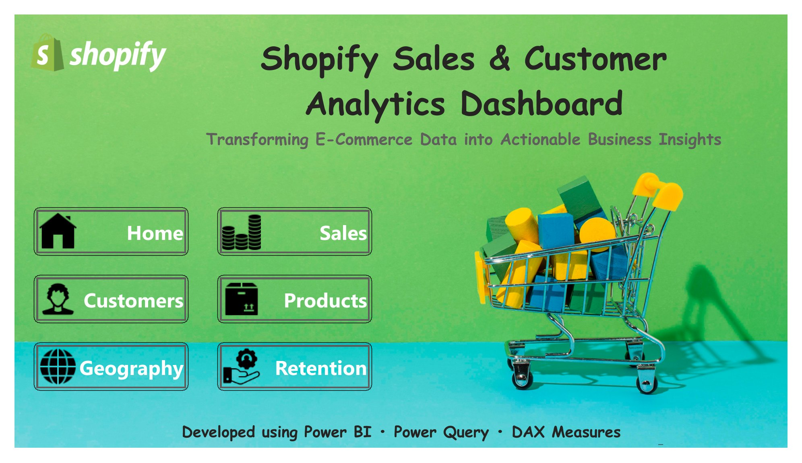
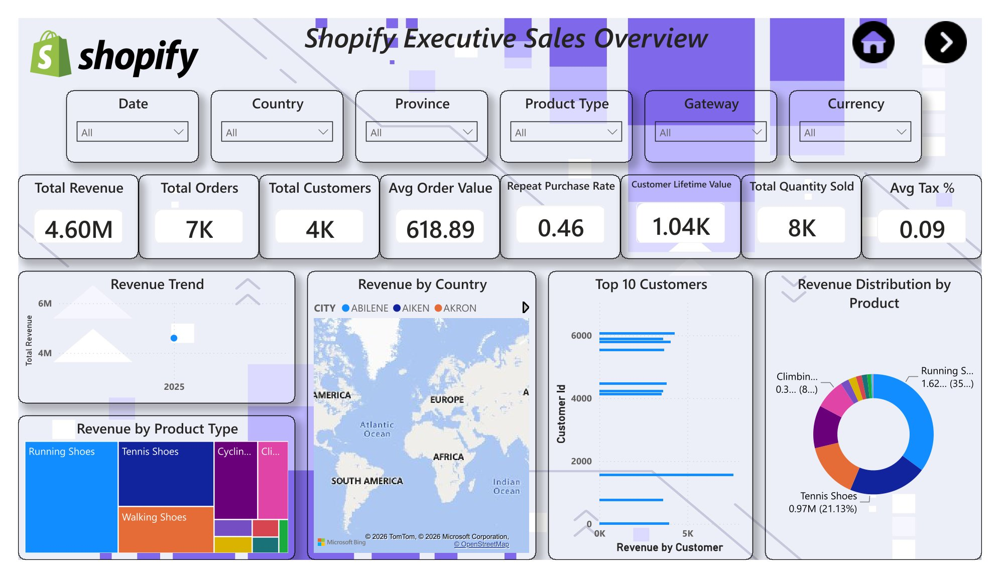
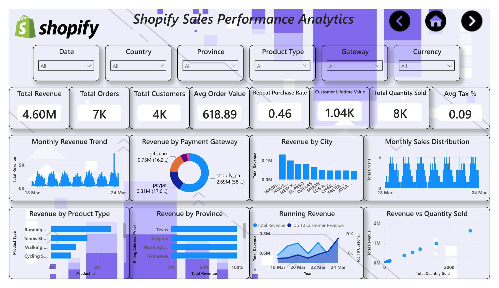
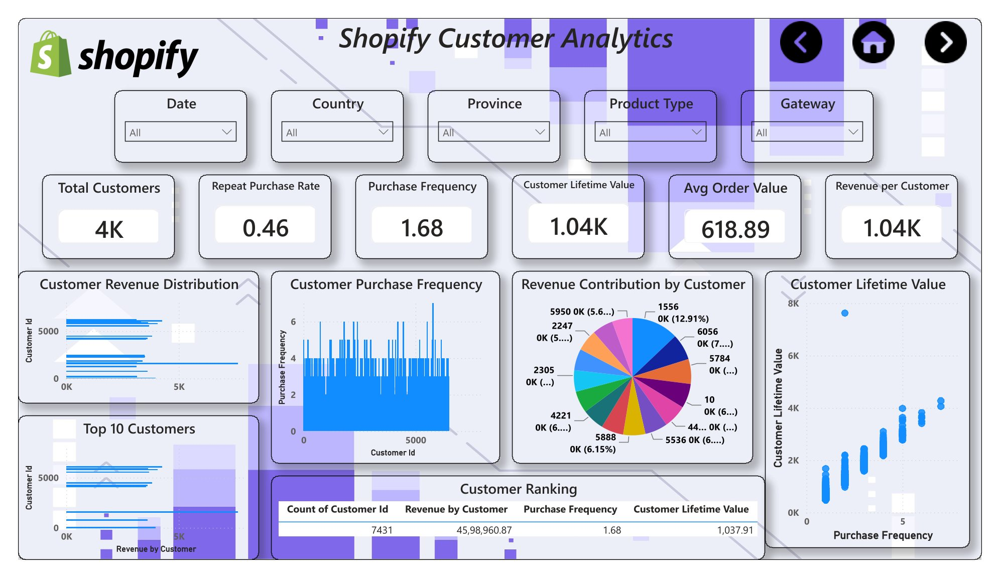
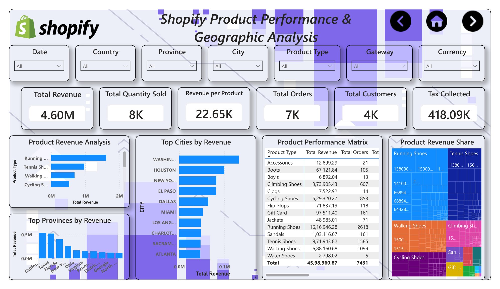
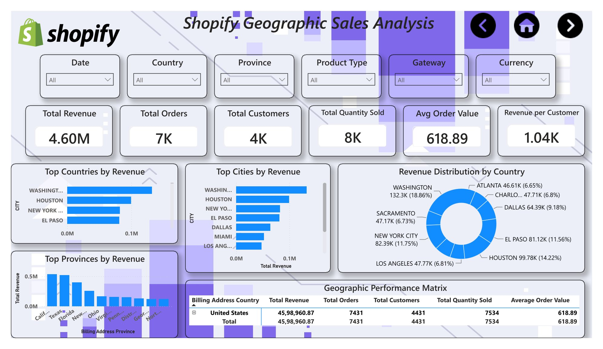
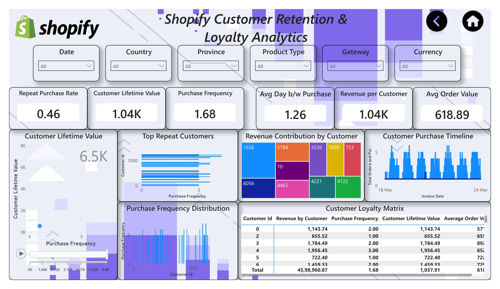

<p align="center">
  
</p>

<h1 align="center">Shopify Sales Analysis</h1>

<p align="center">
  <strong>Business Intelligence Project Brief · An Interactive Power BI Dashboard</strong>
</p>

<p align="center">
  
</p>

<p align="center">
  <strong>Transforming E-Commerce Sales Data into Actionable Business Intelligence</strong>
</p>

<p align="center">
  An interactive Power BI dashboard for analyzing sales performance, customer behavior, product trends, geographic distribution, and customer retention.
</p>

<p align="center">
  
  
  
</p>

---

## 📌 Project Overview

**Shopify Sales Analysis** is a Business Intelligence project developed using **Microsoft Power BI and DAX** to transform e-commerce sales data into meaningful business insights.

The dashboard provides an interactive view of key performance indicators, revenue trends, customer purchasing behavior, product performance, and geographic sales distribution to support data-driven business decisions.

### Project Highlights

- Interactive business intelligence dashboards
- KPI monitoring and sales performance analysis
- Customer purchasing and retention analysis
- Product and geographic performance evaluation
- DAX-powered analytical measures
- Business-focused reporting and recommendations

---

## 🎯 Business Objectives

- Monitor overall sales performance and key business KPIs.
- Analyze revenue trends and monthly growth.
- Understand customer purchasing behavior and lifetime value.
- Identify high-performing products and product types.
- Evaluate geographic sales performance.
- Analyze repeat purchases and customer retention.
- Develop actionable recommendations from business data.

---

## 🛠️ Tools & Technologies

| Technology | Application |
|---|---|
| Microsoft Power BI | Interactive dashboard development |
| DAX | KPI calculations and business metrics |
| Power Query | Data preparation and transformation, where applicable |
| Data Modeling | Structuring data for analytical reporting |

---

## 📊 Dashboard Preview

Explore the analytical pages of the Shopify Sales Analysis dashboard.

### 🏠 1. Home




### 🏠 2. Executive Overview



*Provides a consolidated view of business KPIs and overall sales performance.*

### 📈 3. Sales Performance



*Analyzes revenue trends, sales performance, and changes over time.*

### 👥 4. Customer Analytics



*Explores customer activity, purchasing patterns, and customer value.*

### 🛍️ 5. Product Analysis



*Evaluates product performance and identifies key sales contributors.*

### 🌍 6. Geographic Analysis



*Examines sales distribution across countries, provinces, and regions.*

### 🔄 6. Customer Retention



*Analyzes repeat purchasing behavior and customer retention patterns.*

---

## 📈 Key Performance Indicators

The dashboard uses DAX measures to monitor important business metrics.

| KPI | Business Purpose |
|---|---|
| Total Revenue | Measures overall sales value |
| Total Orders | Tracks order volume |
| Total Customers | Measures the customer base |
| Total Quantity Sold | Tracks product sales volume |
| Customer Lifetime Value (CLV) | Evaluates customer value using the implemented calculation |
| Repeat Purchase Rate | Measures repeat customer purchasing |
| Month-over-Month Growth | Compares performance with the previous month |
| Year-over-Year Growth | Compares performance with the corresponding prior-year period |
| Customer Retention | Evaluates returning customer behavior |

*Actual KPI definitions depend on the DAX measures implemented in the Power BI file.*

---

## 🔍 Business Questions Addressed

- How is overall revenue performing?
- Which months show the strongest sales performance?
- Which products contribute most to revenue?
- Which geographic regions generate the highest sales?
- How do customers contribute to overall business performance?
- What percentage of customers make repeat purchases?
- What opportunities exist to improve customer retention?

---

## ⚙️ Analytical Workflow

1. **Data Understanding** — Review the dataset and its business context.
2. **Data Preparation** — Validate and transform data for reporting.
3. **Data Modeling** — Organize the data model for analysis.
4. **DAX Development** — Create measures for KPIs and business metrics.
5. **Dashboard Design** — Build interactive visuals, KPI cards, and filters.
6. **Business Analysis** — Interpret trends and performance patterns.
7. **Recommendations** — Identify potential opportunities for improvement.

---

## 📁 Repository Structure

```text
shopify-sales-analysis/
│
├── README.md
│
├── dashboard/
│   └── Shopify_Sales_Analysis.pbix
│
├── preview/
│   ├── shopify-logo.png
│   ├── Executive Overview.png
│   ├── Sales Performance.png
│   ├── Customer Analytics.png
│   ├── Product Analysis.png
│   ├── Geographic Analysis.png
│   └── Customer Retention.png
│
└── report/
    └── Shopify_Sales_Analytics_Report.pdf
```

*This is the recommended structure. Include only files and folders that actually exist in your repository.*

---

## 💡 Business Value

The dashboard helps stakeholders:

- Monitor sales performance through consolidated KPIs.
- Identify revenue trends and performance changes.
- Understand customer and product contributions.
- Compare sales across geographic markets.
- Evaluate repeat purchasing and retention.
- Support data-driven business planning.

---

## ⚠️ Scope & Limitations

- Insights depend on the quality and coverage of the source dataset.
- Historical patterns do not guarantee future performance.
- Retention and customer lifetime value depend on their implemented calculation methods.
- The dashboard supports descriptive and diagnostic analysis rather than proving causation.

---

## 🚀 How to Access the Dashboard

1. Clone or download this repository.
2. Install Microsoft Power BI Desktop.
3. Open `dashboard/Shopify_Sales_Analysis.pbix`.
4. Refresh the data source if prompted.
5. Explore the dashboard pages using the available filters and slicers.

**Requirements:** Microsoft Power BI Desktop and access to the required source data.

---

## 👨‍💻 Author

**Ayush Dash**

Data Analytics & Business Intelligence Portfolio

**Project:** Shopify Sales Analysis  
**Primary Tools:** Microsoft Power BI · DAX

---

## 📚 References

- [Microsoft Power BI Documentation](https://learn.microsoft.com/en-us/power-bi/)
- [Microsoft DAX Documentation](https://learn.microsoft.com/en-us/dax/)

---

## 🏁 Conclusion

The Shopify Sales Analysis project demonstrates how Power BI and DAX can transform e-commerce sales data into an interactive Business Intelligence solution.

Through sales, customer, product, geographic, and retention analysis, the dashboard provides meaningful insights to support performance monitoring and informed business decisions.

---

<p align="center">
  <strong>Shopify Sales Analysis</strong>
  <br/>
  Business Intelligence · Interactive Reporting · Data-Driven Decisions
</p>
